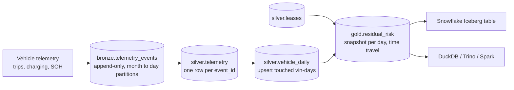

# Iceberg Lakehouse: EV Battery Health and Lease Residual Risk

[](https://github.com/Kolli-Jahnavi-07/iceberg-lakehouse/actions/workflows/ci.yml)

**Stack:** Python · Apache Iceberg (PyIceberg) · Parquet · DuckDB · PyArrow · AWS Glue / Iceberg REST catalog · Snowflake Iceberg tables · GitHub Actions

A lessor carries the residual-value risk of every EV it leases, and **battery state of health (SOH)** is the biggest driver of an EV's resale value. This lakehouse ingests connected-vehicle telemetry into **Apache Iceberg** tables and publishes a daily residual-risk report per lease.

It's built to show the Iceberg features that matter in production, each one exercised by the demo and checked by tests:

| Feature | Where it's used | Test |
|---|---|---|
| ACID appends, idempotent per batch | Bronze records the batch id in the snapshot summary; re-running a batch is a no-op | `test_rerunning_a_batch_is_a_no_op` |
| Upserts (MERGE) | `vehicle_daily` is upserted for exactly the (vin, day) pairs a batch touched, including late events | `test_daily_aggregates_match_a_reference...` |
| **Schema evolution** | A firmware update starts sending `firmware_version`; the column is added without rewriting data, and old snapshots still read with their old schema | `test_schema_evolution_adds_firmware_version...` |
| **Partition evolution** | Bronze starts partitioned by month and moves to daily partitions when volume grows. Old files keep their spec, and queries prune both | `test_partition_evolution_keeps_old_files...` |
| Hidden partitioning and pruning | Queries filter on `event_ts`; Iceberg maps that onto month or day partitions. A one-day query plans 4 of 237 files | same test |
| **Time travel** | Every gold refresh is a snapshot tagged with its as-of date, so last month's report can be reproduced exactly | `test_gold_time_travel_reproduces_a_past_report` |
| Optimistic concurrency | Concurrent writers are serialized by compare-and-swap commits; no write is lost | `test_concurrent_writers_never_lose_a_commit` |
| Compaction | Small files from daily batches and late events are rewritten per partition (237 → 90 files) | `test_compaction_reduces_files_and_keeps_every_row` |
| Snapshot expiry | Old snapshots are expired so storage can be reclaimed; current data is untouched | `test_expiring_snapshots_keeps_current_data` |
| Open format | The same tables are readable from Snowflake, Spark, Trino and Athena (`snowflake/iceberg_tables.sql`) | n/a |



## Demo output

`make demo`: 250 leased EVs, 90 days, 47,351 events, about 3% arriving 1–3 days late and 1% delivered twice.

```
day   0  bronze +  512  silver +  511  dupes dropped   1  daily rows  221  0.3s
day  45  partition evolution: bronze month -> day (no data rewritten)
day  60  schema evolution: new column(s) firmware_version
...
re-running the first batch: skipped (already committed)

bronze files by partition spec: {0: 48, 1: 189}; a one-day query plans 4 of 237 files
time travel: 40 leases changed risk tier between 2026-02-14 and today

current residual-value exposure:
  HIGH      26 leases  projected SOH  74.4%  DC fast  60%  $   206,724 at risk
  MEDIUM    53 leases  projected SOH  90.5%  DC fast  20%  $    39,678 at risk
  LOW      171 leases  projected SOH  94.7%  DC fast  17%  $         0 at risk

maintenance: compacted 47 partitions, bronze files 237 -> 90, expired 177 old snapshots
```

The HIGH tier is dominated by vehicles that DC fast charge for most of their energy in hot states, which is the pattern the generator plants and the scoring is meant to surface.

## How the risk score works

For each lease, from the last 45 days of `vehicle_daily`:

- **SOH loss per 10,000 km** = (SOH at window start − SOH now) / km driven in the window
- **Projected SOH at lease return** = SOH now − loss rate × recent monthly km × months remaining
- **Tier:** HIGH below 88%, MEDIUM below 92%, LOW otherwise
- **Residual at risk** ≈ residual value × 1.5% per SOH point below 92% (a simple rule of thumb, kept in one SQL expression so it's easy to replace with a pricing model)

## Design notes

- **Bronze is append-only and idempotent.** Each commit carries `lakehouse.batch-id` in its snapshot summary. Before writing, the pipeline checks the table's own history, so a retried job can't double-load without a separate bookkeeping table.
- **Silver de-duplicates with an anti-join, not an upsert.** Events are immutable, so a duplicate only needs to be dropped. The lookup is pruned to the batch's time window first, so it reads a few files instead of the whole table.
- **Late data only touches what it affects.** `vehicle_daily` is recomputed for the (vin, day) pairs present in the batch and upserted, so an event arriving three days late corrects that one day.
- **The catalog is configuration.** Locally a SQLite `SqlCatalog`, in production AWS Glue or an Iceberg REST catalog (Snowflake Open Catalog / Polaris) through PyIceberg's environment variables ([docs/catalogs.md](docs/catalogs.md)). No code changes.
- **DuckDB is the compute engine** for transformations here because it reads Arrow directly from Iceberg scans. Swapping in Spark for larger volumes changes the engine, not the tables.

## Repository layout

```
src/lakehouse/
  tables.py        catalog, schemas, partition specs, sort order, table properties
  pipeline.py      bronze -> silver -> daily -> gold, schema/partition evolution, time travel
  maintenance.py   compaction per partition (any spec), snapshot expiry
  generator.py     synthetic fleet telemetry with late, duplicate and new-field events
  __main__.py      demo and an ad hoc DuckDB query command
snowflake/iceberg_tables.sql   read the gold table from Snowflake via Glue
docs/catalogs.md               running against Glue or a REST catalog
tests/                         11 tests over a 64-day run
```

## Run it

```bash
pip install -r requirements.txt
make test                                  # ~75 s
make demo                                  # ~4 min, 250 vehicles x 90 days
PYTHONPATH=src python -m lakehouse query "SELECT risk_tier, COUNT(*) FROM gold_residual_risk GROUP BY 1"
```

All data is synthetic. Model names are used only to give vehicles realistic battery sizes.

## Author

**Sai Jahnavi Kolli**, Data Engineer · [saijahnavikolli.com](https://saijahnavikolli.com) · [LinkedIn](https://www.linkedin.com/in/kolli-sai-jahnavi) · [GitHub](https://github.com/Kolli-Jahnavi-07)
